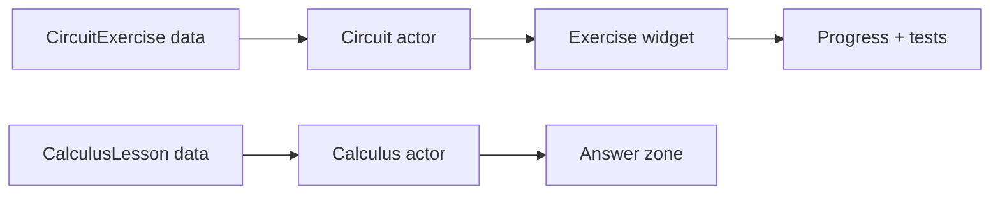

# Capture guide — screenshots and GIF

This repository is a source study, so the honest way to show it is **not** to fake
gameplay. Two acceptable options:

- **Option A — capture from the original project.** Take 3 frames in the editor of
  the full Unreal project this source came from, and caption them clearly as
  "captured from the original project, not rebuildable from this repository".
- **Option B — show the code.** A diagram plus one annotated source excerpt. No
  gameplay imagery at all.

Do not mix the two without labeling: an image of the full game placed above a
source-only repository reads as a demo that does not exist.

## Option A — shots

| File | Frame |
| --- | --- |
| `docs/screenshots/01-circuit-lab.png` | Circuit workstation with the exercise widget open |
| `docs/screenshots/02-calculus.png` | Calculus classroom with the interaction zone |
| `docs/screenshots/03-carry.png` | Player carrying an object between stations |

Save under `docs/screenshots/` and add this block after the intro:

```markdown
> Images captured from the original Unreal project. This repository contains only
> the C++ source and design data, not the assets needed to rebuild these frames.

| Circuit lab | Calculus | Interaction |
| --- | --- | --- |
|  |  |  |
```

## Option B — diagram

A `mermaid` block in the README is enough to make the code readable:



## Honesty rule

Keep the existing "not compiled or play-tested" note. It is the reason the rest of
this README can be trusted.
